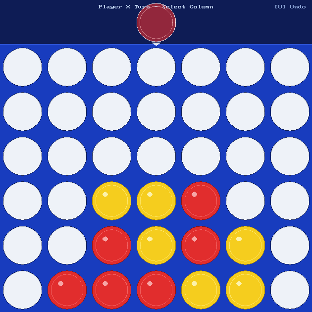
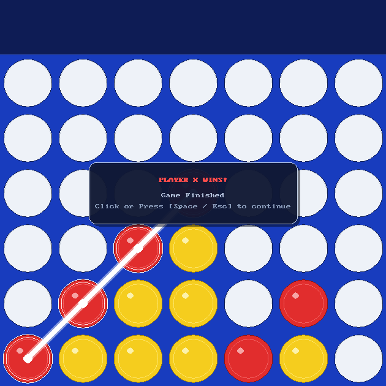

# Connect Four

Connect Four in C11 with an SDL2 graphical window, an ANSI terminal fallback, and a Minimax AI opponent. Supports arbitrary board dimensions from 4x4 up to 11x11, move undo, match persistence, and replay visualization.

## Screenshots

| Gameplay & Hover Preview | Winning Line Highlight |
| :---: | :---: |
|  |  |

## Features

- **Dual interfaces**: Interactive SDL2 window (with animated piece drops, hover previews, and win overlays) or an ANSI terminal interface.
- **Minimax AI**: Depth-limited search with Alpha-Beta pruning, dynamic depth scaling based on board size, and center-out move ordering. Also includes random and 1-ply heuristic modes.
- **Move undo**: Roll back moves in both GUI (`u`, `Ctrl+Z`, `Backspace`) and CLI (`u`) modes. Reverts both player and AI turns during AI matches.
- **Persistence & replay**: Save matches to `database.dat` and step through replays with visual board playback.
- **CLI options**: Pass command-line flags to bypass setup menus and launch directly.

## Architecture

The project is structured into modular components with clean separation of concerns:

- `engine.c` / `engine.h`: Core game state representation, rule validation, win/draw detection, and the main game loop using function pointers for player moves and rendering.
- `players.c` / `players.h`: Player controllers implementing a uniform `MoveFn` interface for human terminal input, file-based moves, and the Minimax AI.
- `gui.c` / `gui.h`: SDL2 rendering pipeline handling window management, mouse interaction, piece drop animations, and game-over modals.
- `config.c` / `config.h`: Command-line argument parsing (`getopt_long`) and interactive setup menus.
- `database.c` / `database.h`: Match serialization, save management, and replay loading.

## Requirements

Install the SDL2 and SDL2_gfx development packages:

### Debian / Ubuntu
```bash
sudo apt install build-essential libsdl2-dev libsdl2-gfx-dev
```

### Fedora
```bash
sudo dnf install gcc make SDL2-devel SDL2_gfx-devel
```

### Arch Linux
```bash
sudo pacman -S base-devel sdl2 sdl2_gfx
```

## Build & Run

Build the release binary:
```bash
make
./connect4
```

Build and launch directly into GUI vs Hard AI:
```bash
make run
```

Build with debug symbols and AddressSanitizer:
```bash
make debug
```

## CLI Usage

```text
Usage: ./connect4 [OPTIONS]

Options:
  -g, --gui                Launch graphical SDL2 window mode
  -c, --cli                Launch text/console mode
  -p, --pvp                Human vs Human mode
  -a, --ai <level>         Human vs AI mode (0=Easy, 1=Medium, 2=Hard)
  -f, --file <path>        File input mode (read moves from file)
  -r, --replay [name]      Replay mode (optional save name)
  -d, --dim <RxC>          Board dimensions (e.g. 6x7, 8x8)
  -R, --rows <rows>        Number of rows (4-11)
  -C, --cols <cols>        Number of columns (4-11)
  -h, --help               Display help
```

### Examples

```bash
# Play against Hard AI in GUI mode
./connect4 --gui --ai 2

# 8x8 board in terminal mode vs Medium AI
./connect4 --cli --ai 1 --dim 8x8

# Replay a saved match
./connect4 --gui --replay save1

# Interactive prompt menu
./connect4
```

## Controls

| Action | GUI | CLI |
| :--- | :--- | :--- |
| Select Column | Left click | Column index (`0` to `cols-1`) |
| Undo Move | `u`, `Ctrl+Z`, `Backspace` | `u` |
| Quit Match | Close window | `q` |
| Advance Replay | Left click / `Space` | `Enter` |
| Dismiss Game Over | Left click / `Space` / `Esc` | Auto-advances |
